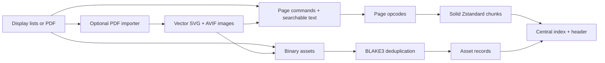

# HyperDoc Encoder

<p align="center">
  <a href="https://github.com/younsabood/hdoc-encoder"></a>
  
  
  <a href="LICENSE"></a>
</p>

Create searchable HyperDoc (`.hdoc`) files from page display lists, vector
paths, text, and binary assets. The encoder is a standalone Rust crate; it does
not depend on the decoder or a shared workspace.

> [!IMPORTANT]
> PDF support is optional. Without `pdf-ingest`, the crate only builds HDOC
> files from caller-provided page commands and assets.

## Explore

| Guide | What it covers |
| --- | --- |
| [Quick start](docs/quickstart.md) | Build a document and import a PDF |
| [API reference](docs/api.md) | Builder, page commands, compression, and statistics |
| [Architecture](docs/architecture.md) | Encoder modules and asset pipeline |
| [File format](docs/format.md) | HDOC header, chunks, index, and page opcodes |
| [PDF import](docs/pdf-ingest.md) | Optional PDF conversion and test fixtures |
| [Diagrams](docs/diagrams/README.md) | Mermaid source diagrams (`.mmd`) |

## Capabilities

| Feature | Details |
| --- | --- |
| Display-list encoder | Encodes drawing commands, SVG fallbacks, and searchable UTF-8 page text. |
| Chunked compression | Writes independently addressable Zstandard page chunks. |
| Asset deduplication | Deduplicates identical bytes using BLAKE3 fingerprints. |
| Vector paths | Encodes reusable paths as HPTH bytecode and can train a shared Zstandard dictionary. |
| Optional PDF import | Converts PDF pages to vector SVG, extracts searchable text, and converts embedded raster images to AVIF. |
| Compression profiles | Choose archival, balanced, or ultra-light Zstandard settings. |

## Encoding pipeline



Editable diagram source: [encoder-flow.mmd](docs/diagrams/encoder-flow.mmd).

## Quick example

Add the crate from GitHub:

```toml
[dependencies]
hdoc-encoder = { git = "https://github.com/younsabood/hdoc-encoder" }
```

Create a page and write it to disk:

```rust,no_run
use hdoc_encoder::{GlyphOffset, HdocEncoderBuilder, PageDisplayList};

fn main() -> Result<(), Box<dyn std::error::Error>> {
    let mut page = PageDisplayList::new(612, 792);
    page.draw_glyph_run(
        vec![301, 145, 88],
        vec![
            GlyphOffset { dx: 0, dy: 0 },
            GlyphOffset { dx: 21, dy: 0 },
            GlyphOffset { dx: 19, dy: 0 },
        ],
    )?;

    let mut encoder = HdocEncoderBuilder::new();
    encoder.add_page_with_text(page, "Searchable page text")?;
    encoder.metadata("title", "Example document");
    encoder.write_to_path("example.hdoc")?;
    Ok(())
}
```

For PDF import, enable the feature and call `import_pdf_path`; see the [PDF
guide](docs/pdf-ingest.md). The text remains searchable Unicode while page
graphics remain vector content.

## Chunking and profiles

The default builder uses the archival profile (Zstandard level 22), with a
maximum of 64 pages and an 8 MiB uncompressed target per chunk. Use
`CompressionProfile::Balanced` or `CompressionProfile::UltraLight` when lower
encoding cost matters more than the smallest output. See [API reference](docs/api.md).

## Community and license

| Resource | Purpose |
| --- | --- |
| [MIT License](LICENSE-MIT) · [Apache 2.0](LICENSE-APACHE) | Dual license, at your option |
| [Contributing](CONTRIBUTING.md) | Local checks and pull requests |
| [Code of Conduct](CODE_OF_CONDUCT.md) | Community expectations |
| [Security policy](SECURITY.md) | Private vulnerability reporting |

The project is licensed under either [MIT](LICENSE-MIT) or [Apache 2.0](LICENSE-APACHE), at your option.
